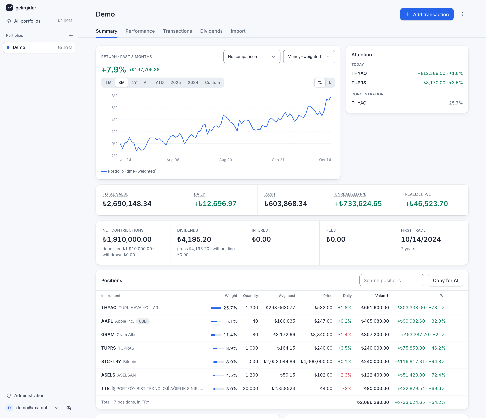
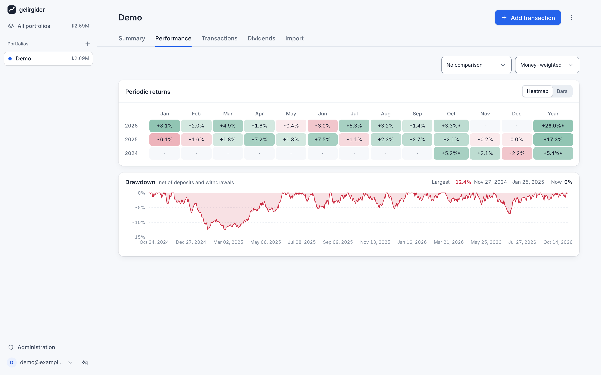
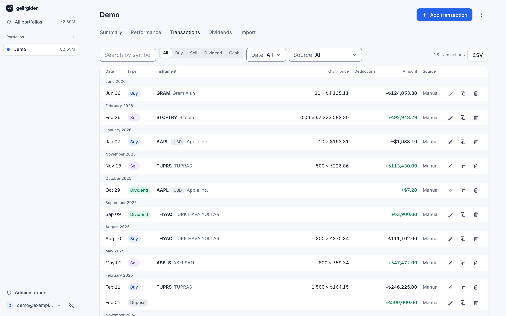

# gelirgider

Türkçe: [README.tr.md](README.tr.md)

Multi-user portfolio tracking tool. BIST, US stocks, TEFAS funds, crypto and gold.

- Backend: Go, stdlib `net/http`, SQLite (kept as the production datastore, see
  [ADR 0002](docs/adr/0002-production-datastore-and-migrations.md))
- Frontend: React + TypeScript + Vite
- Backend and frontend deployed separately

## Features

- Several portfolios per user, plus an all-portfolios view that adds them up.
- Multi-currency: amounts in TRY, USD or EUR, shown in the reporting currency
  each user picks.
- Returns as simple, time-weighted (TWR) or money-weighted (MWR) return.
- Benchmarks: compare a portfolio with USD, EUR, BIST 100, Turkish CPI (TÜFE),
  gold or one of its own positions.
- Dividends and stock splits.
- Statement import from Midas, Garanti BBVA and Garanti BBVA Yatırım
  statements, and from a generic CSV file.
- An admin area for provider API keys, the price fetch schedule, registration
  and users.

The UI is in Turkish (`tr`, the default) and English (`en`), chosen with the
language switch. The choice is stored in the browser only.

## Screenshots

The Demo portfolio from the `-demo` seed (see [Development](#development)).



Summary: the return over a chosen range, the portfolio totals and the positions.



Performance: returns by month and year, and the drawdown over time.



Transactions: every trade, dividend and cash movement, with filters and CSV export.

## Documentation

- [docs/ROADMAP.md](docs/ROADMAP.md): work in progress, what is next and the non-goals
- [docs/HISTORY.md](docs/HISTORY.md): shipped phases and what each one delivered
- [docs/PRINCIPLES.md](docs/PRINCIPLES.md): guiding principles
- [docs/adr/](docs/adr/): architecture decision records
- [deploy/README.md](deploy/README.md): production deployment with Docker Compose
- [deploy/RUNBOOK.md](deploy/RUNBOOK.md): operating a deployed instance
- [frontend/README.md](frontend/README.md): frontend notes
- [CONTRIBUTING.md](CONTRIBUTING.md): how to contribute, run the checks and format a pull request
- [SECURITY.md](SECURITY.md): reporting a vulnerability
- [CLAUDE.md](CLAUDE.md): the maintainers' agent workflow rules

## Development

Prerequisites: Go 1.26+ and Node.js 22.22.2 or a later 22.x release, 24.15.0 or
a later 24.x release, or 26.0.0 and newer. Node 23 and 25 are not supported,
and the frontend test and lint tooling does not run on Node 20.

US stock prices need Finnhub (latest close) and Tiingo (daily-close history)
API keys, and the BIST 100 benchmark needs a TCMB EVDS API key (free account
at <https://evds3.tcmb.gov.tr>, key on its profile page). Enter them in
Yönetim / Administration after setup; everything else works without them.
TEFAS fund prices are off by default: the TEFAS endpoint is disallowed by
tefas.gov.tr's robots.txt, so until you turn the `tefas` source on in the same
place, the daily schedule, the startup catch-up and backfill,
`server -backfill-prices`, "Backfill all", the fetch after a transaction is
saved or imported and the statement import's fund lookup all skip TEFAS.
Asking for the source by name still fetches from TEFAS while it is off: its
"Run now" and "Backfill" buttons, `server -fetch tefas` and
`go run ./cmd/symbols -market tefas`.

```
(cd frontend && npm ci)
make dev
```

`npm ci` installs the frontend dependencies (again after
`frontend/package-lock.json` changes). `make dev` starts both dev servers; the
backend fetches prices with its built-in scheduler. Ctrl+C stops both.

- Backend: http://localhost:8080
- Frontend: http://localhost:5173
- API docs (Swagger UI, dev only): http://localhost:8080/api/docs/

The dev backend listens on `127.0.0.1` only (`make dev` sets `HOST`), so
other devices on the LAN cannot reach it directly.

The first `make dev` leaves two files behind: a generated
`SECRET_KEY` appended to `.env` (keep it, it encrypts the stored provider
keys) and the dev database at `backend/gelirgider.db`. Both are gitignored.

The API spec in `backend/apidocs/` is committed, so `make dev` serves it as
is. Only `make swagger` (regenerate it, then commit it) and `make lint`
(check it is fresh) run `swag`, and their first run needs network access to
fetch it.

To run the backend on another port, for example next to a second checkout,
set `PORT` for both: `PORT=8081 make dev`. The frontend dev server proxies
`/api` to that port; its own port moves to the next free one.

On a fresh database every page redirects to `/setup`: enter the
`setup_token` printed in the backend output to create the admin.

For a populated database without network or API keys, run
`(cd backend && go run ./cmd/server -demo)` before `make dev`: it creates the
admin `demo@example.com` with a Demo portfolio of synthetic trades, dividends,
prices and FX rates over the last two years, and prints the password. It
refuses a database that already has a user.

`make screenshots` regenerates the pictures under [Screenshots](#screenshots)
from the same demo seed, in a throwaway database with the price fetches
switched off. It needs Google Chrome (set `CHROME` to its binary when it is
not in the default place) and the `sqlite3` command.

`make test` runs `go vet` and the backend tests, then the frontend lint and
tests. `make lint` runs the swag spec check, `gofmt`, `go vet`, `golangci-lint`
(`dupl`, `forbidigo`, `funlen` with `lines` 150 (comments ignored, tests
exempt), `gocognit` with `min-complexity` 45, `nestif` with `min-complexity` 10,
`noctx`, `revive` with `argument-limit` 6 and `usestdlibvars` with
`time-layout`, configured in `backend/.golangci.yml`), `deadcode`, the frontend lint, `jscpd`
(copied blocks of 6 lines or more, configured in `frontend/.jscpd.json`), `knip`
(unused exports and types, configured in `frontend/knip.json`) and the
prettier checks on `frontend/`, `docs/`, `deploy/`, `.claude/` and the root
Markdown files.
`make build-frontend` type-checks and builds the frontend for production into
`frontend/dist/`; neither of the other two runs it. Run `make help` for all
available targets.

## Data sources

gelirgider fetches market data from these providers. Symbol lists and test
fixtures taken from them are committed under `backend/`.

| Provider                                      | Used for                                          | Access                                                                              |
| --------------------------------------------- | ------------------------------------------------- | ----------------------------------------------------------------------------------- |
| Borsa İstanbul daily bulletin                 | BIST closes, the BIST symbol list                 | Public                                                                              |
| İş Yatırım capital increase and dividend page | BIST splits and dividends                         | Public                                                                              |
| TEFAS                                         | Fund prices, the fund list                        | Off by default: tefas.gov.tr's robots.txt disallows the endpoint, the admin opts in |
| TCMB daily exchange rate bulletin             | USD and EUR rates                                 | Public                                                                              |
| TCMB EVDS                                     | BIST 100 benchmark                                | Free account; each instance enters its own key                                      |
| TÜİK data portal                              | Turkish CPI (TÜFE) benchmark                      | Public; TÜİK asks for source attribution: Kaynak / Source: TÜİK                     |
| Finnhub                                       | US latest close                                   | Each instance enters its own key; free tier for personal use                        |
| Tiingo                                        | US daily close history                            | Each instance enters its own key; free tier for personal use                        |
| BtcTurk                                       | Crypto and gram gold prices, the crypto pair list | Public                                                                              |
| Nasdaq Trader symbol directory                | The US symbol list                                | Public                                                                              |

The gold symbol list is hand-written. Whoever runs an instance fetches this
data on their own behalf and is bound by the terms of each provider they turn
on or accept a key from.

## License

Copyright (C) 2026 Doğa Uzuncukoğlu

gelirgider is free software, licensed under the GNU Affero General Public
License, version 3 only (AGPL-3.0-only). See [LICENSE](LICENSE). The licenses
of the bundled third-party software are in
[THIRD_PARTY_NOTICES.md](THIRD_PARTY_NOTICES.md); `make notices` regenerates
it.
